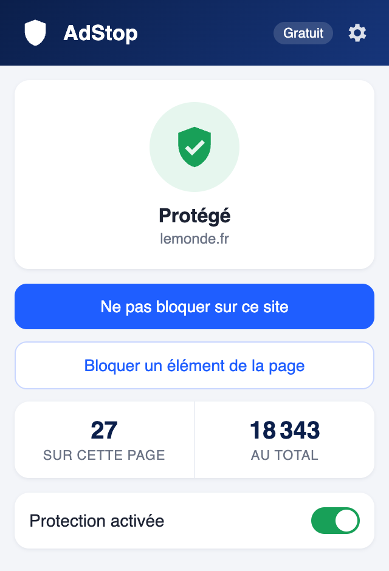
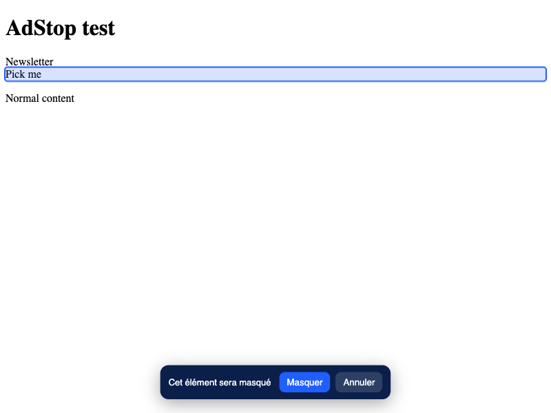
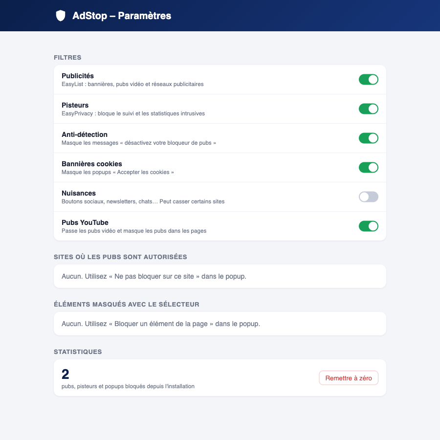

# AdStop

A free, open-source ad blocker for Chrome (Manifest V3). The interface is in French.

<p align="center"></p>

## Features

- **Ads and trackers** blocked with EasyList and EasyPrivacy (about 120,000 rules)
- **Popups, popunders and forced redirects** to other sites are stopped
- **YouTube**: video ads are skipped automatically and ad slots are hidden
- **Cookie banners** hidden (Fanboy Cookie Monster list)
- **"Disable your ad blocker" walls** hidden (Anti-Adblock Killer list)
- **Annoyances** (social buttons, newsletter popups, chat widgets): optional, off by default
- **Block an element**: click any annoying thing on a page and it stays hidden on that site
- **One click to allow ads** on a site you want to support
- **Counter** on the icon for the current page, plus a total
- **Lists updated every week** automatically (GitHub Action, new release each time)

## Install

1. Download the latest zip from [Releases](../../releases) (or **Code → Download ZIP**) and unzip it.
2. Open `chrome://extensions` and turn on **Developer mode** (top right).
3. Click **Load unpacked** and pick the `adstop` folder.

## Screenshots

| Element picker | Settings |
| --- | --- |
|  |  |

## Building the filter lists yourself

```bash
cd tools
npm install
node fetch.mjs     # download the lists into lists-raw/
node convert.mjs   # network rules  -> adstop/lists/*.json
node cosmetic.mjs  # hiding rules   -> adstop/lists/*.css and *.sites.json
```

The list sources are in `tools/lists.mjs`.

## Privacy

AdStop collects nothing and sends nothing anywhere. Settings and counters stay in your browser.

## Credits and license

Filter lists: [EasyList, EasyPrivacy](https://easylist.to/), [Fanboy](https://www.fanboy.co.nz/) (GPLv3 / CC BY-SA 3.0).
Rule conversion: [@adguard/tsurlfilter](https://github.com/AdguardTeam/tsurlfilter).
AdStop is released under the **GNU GPL v3** (see `LICENSE`).
AdStop is an independent project. It is not affiliated with AdBlock, AdBlock 360, EasyList or YouTube.
